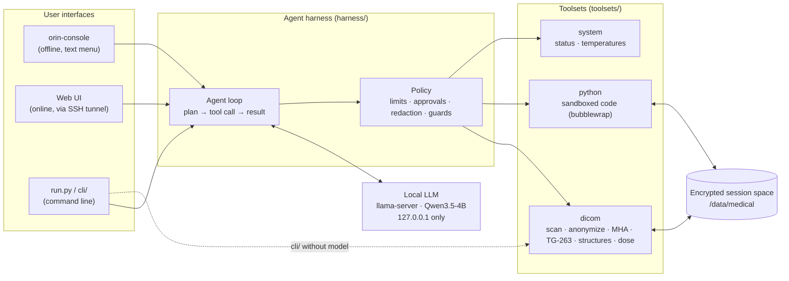
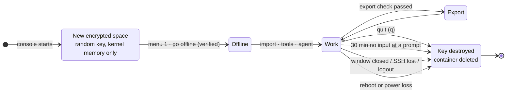
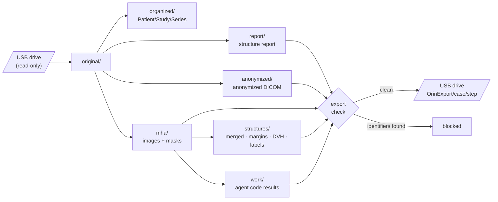
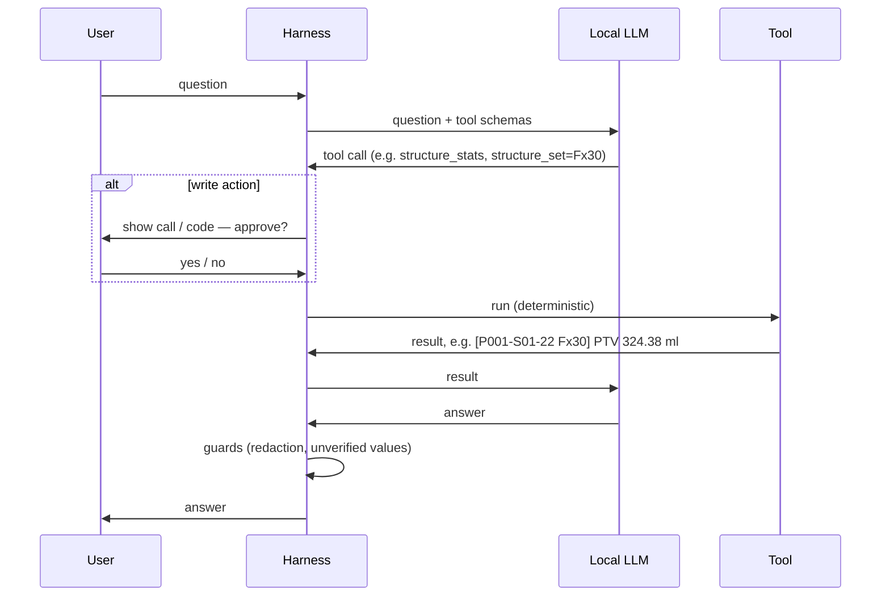

# MedData Agent


A local, offline assistant for DICOM and radiotherapy (RT) data on an NVIDIA Jetson Orin Nano.
A small language model plans the work; **deterministic, tested tools** do it. Patient data never leaves the device:
it is processed offline in a temporary encrypted space that is destroyed when the session ends.

**What it does**

- Reads messy DICOM folders and reports patients, studies, series and RT objects (RTSTRUCT, RTPLAN, RTDOSE)
- Anonymizes DICOM (dicognito + extra rules, verified file by file)
- Exports images and RT structures to MHA (one binary mask per structure, per plan / fraction)
- Standardizes structure names to AAPM TG-263, including German clinical names
- Structure and dose analysis: volumes, Dice / HD95, D95 / Vx, DVH, margins, unions, label maps
- Answers questions in natural language through a local LLM agent that calls these tools

---

## Contents

1. [Architecture](#architecture)
2. [Data protection model](#data-protection-model)
3. [Case workflow](#case-workflow)
4. [Quick start](#quick-start)
5. [Components](#components)
6. [DICOM and RT functions](#dicom-and-rt-functions)
7. [Agent design](#agent-design)
8. [Security summary](#security-summary)
9. [Testing and validation](#testing-and-validation)
10. [Versioning and deployment](#versioning-and-deployment)
11. [Extending](#extending)
12. [Repository layout](#repository-layout)
13. [Limitations](#limitations)

---

## Architecture



- **The model never touches files.** It can only call tools; every tool is ordinary, tested Python code.
- **Write actions need approval.** Anything that writes (anonymize, export, merge, code) is shown to the user first.
- **The same functions run without a model** from `cli/` and from console menu 5.

---

## Data protection model

Patient data is processed with the Orin **offline**, operated with its own screen and keyboard. Each session gets
a **new** encrypted space; when the session ends, its key is gone and the data is unrecoverable.



| Measure | How |
|---|---|
| Encryption | plain dm-crypt, AES-XTS-512; 64-byte random key from `/dev/urandom`, no passphrase, never stored |
| Offline gate | import, tools, agent and export run only when `orin-offline status` verifies no network (WiFi, Ethernet, Bluetooth, Tailscale, USB-C, Docker) |
| Test mode | for anonymized or synthetic data only: work while online (`orin-console --test` or menu 8, typed confirmation, logged) |
| Idle timeout | 30 min without input **at a prompt** destroys the space; running work does not count as idle (`ORIN_IDLE_MIN`) |
| No traces | temp files inside the space (`/data/medical/.tmp`), no shell history, no swap; boot service removes leftovers |
| Export check | every exported file is searched for the case's original identifiers; clean steps are blocked on a hit; SHA-256 manifest |

> **Export results before you quit** — nothing can be recovered after the session ends.

---

## Case workflow

One folder per imported case, one sub-folder per processing step. Originals are never changed.



```
/data/medical/case-20261125-01/
├── original/      imported data (never changed)
├── report/        report.html, series.csv, structure.json
├── anonymized/    anonymized DICOM + anonymization_report.txt
├── mha/           <series>.mha, <rtstruct>/<structure>.mha, structures.json, export_report.txt
├── structures/    derived structures, RTSTRUCTs, DVH CSVs, label maps
└── work/          output of agent-written code
```

Case names are pseudonymous (`case-YYYYMMDD-NN`); a name containing an identifier of the imported patients is
replaced automatically.

---

## Quick start

On the Orin's own screen:

```bash
orin-console            # creates a new encrypted space
```

```
1  Go offline / online          5  Run a tool (report / organize / anonymize / MHA / structures)
2  Session space status         6  Export a result to USB (with identifier check)
3  Import from USB drive        7  Status and offline log
4  Ask the agent                8  Test mode (anonymized / synthetic data only)
q  Quit = destroy the session space
```

Typical session: **1** go offline → **3** import → **4** ask or **5** run a tool → **6** export → **q** quit.

Example questions for the agent:

```
How many fractions are there, and which series belong to each?
What is the PTV volume in Fx30?
What is the PTV D95 in the baseline plan, using its own dose?
Compare the GTVp volume of the baseline plan with Fx30.
Export the structures with the masks on the CT of each plan.
```

---

## Components

| Component | Use | Start |
|---|---|---|
| Offline console | patient data, offline, Orin screen | `orin-console` |
| Agent (command line) | scripted questions, testing | `python run.py configs/dicom.json --set folder=… [-q "…"]` |
| Command-line tools | the same functions, no model | `python cli/<tool>.py --help` |
| Web UI | online use with test data | `bin/ui-start.sh`, then `ssh -N -L 8090:127.0.0.1:8090 orin` |
| Model server | local LLM | `bin/llm-start.sh 4b` / `bin/llm-stop.sh` |

**Command-line tools** (`cli/`, run with `~/dicom-env/bin/python`):

| Tool | Purpose |
|---|---|
| `report.py` | structure report of a DICOM folder (HTML, CSV, JSON) |
| `organize.py` | copy into Patient/Study/Series folders, with manifest and verification |
| `anonymize.py` | anonymized DICOM copy with verification report |
| `to_mha.py` | images → MHA, RTSTRUCT → one mask per structure |
| `structure_names.py` | RTSTRUCT names → TG-263, list unmapped names |
| `structures.py` | list · stats · compare · values · dvh · merge · margin · labelmap · crop · resample |

---

## DICOM and RT functions

### Anonymization

- Core: [dicognito](https://github.com/blairconrad/dicognito) — names, IDs, addresses and institutions replaced;
  **all dates shifted by one offset** (date + time intervals kept); **UIDs remapped consistently** (RT references stay valid)
- Extra rules: free text masked for the patient's identifiers; staff names, device serials etc. emptied **inside
  sequences too**; private tags removed; attributes that were empty stay empty (no invented clinic or address)
- Every output file is re-read and checked; the seed is random and not stored (irreversible) unless `--seed` is given
- **Pixel data is not changed** — series that may contain burned-in text are listed for a visual check

### MHA export

One `.mha` per image series and one binary mask per structure, named by TG-263. Headers contain geometry only;
sidecar JSON files contain no names, dates or UIDs.

Reference image for each structure set, in this order:

1. a reference given for that RTSTRUCT (`--ref ID=…`)
2. the requested modality from the RTSTRUCT's own plan folder (`--ref-modality CT|MR`)
3. the image series the RTSTRUCT names itself (default)
4. a reference given for all (`--ref X`) — fallback only
5. an image with the same FrameOfReferenceUID

A reference other than the named series must share its frame of reference; where UIDs are unusable
(e.g. damaged by an earlier anonymizer) the report says so. An earlier result is replaced only on request
(`overwrite=true`, approved).

### TG-263 structure names

Deterministic rules, no model: German and English synonyms, laterality, PRV margins, targets, helpers.

| Original | TG-263 | Rule |
|---|---|---|
| `Rückenmark`, `Myelon` | `SpinalCord` | synonym |
| `Myelon+5mm` | `SpinalCord_PRV05` | PRV |
| `Lunge li` / `Lungen bds` | `Lung_L` / `Lungs` | laterality |
| `Lunge-GTV`, `Lungen ohne PTV` | `Lungs-GTV`, `Lungs-PTV` | organ minus target |
| `GTV_Primarius`, `GTV_LN_2R_4R` | `GTVp`, `GTVn_2R4R` | target classifier |
| `PTV 60Gy`, `PTV_50,4` | `PTV_6000`, `PTV_5040` | target dose (cGy) |
| `H_RING`, `PTV-Ring` | `zRING`, `zPTV_Ring` | helper (`z` prefix) |

Names a clinic uses differently go into `configs/structure_names.csv` (always wins). The export writes
`structure_names_unmapped.csv` as a template.

### Structure and dose tools

Work on the MHA export; results go to `<case>/structures/`, never overwritten, each with a JSON describing the
operation.

- **One structure set per plan or fraction:** every result line names its set, e.g. `[P001-S01-22 Fx30]`;
  `structure_set='Fx30'` / `'baseline'` / an RTSTRUCT id selects one
- **Dose:** `image_series_id='plan_dose'` uses each structure's own plan dose; a single RTDOSE is used only with its
  own plan's structure set
- Margins on a half-voxel grid (3 mm slices do not lose 1.5 mm); different grids are resampled and reported
- `--rtstruct` writes a new RTSTRUCT on the reference CT for import into a TPS (contains the CT's identifiers)

```bash
T="$HOME/dicom-env/bin/python cli/structures.py /data/medical/<case>"
$T stats "GTV*"                       # volume, centroid, extent, parts
$T compare "GTVp" "PTV"               # Dice, Jaccard, HD, HD95, mean surface distance
$T values "PTV" --image P001-S01-40   # Dmean, D98/95/50/2, Vx
$T merge "GTV*" --name GTV_all --margin 5 --rtstruct
```

---

## Agent design



**Tools** (dicom toolset): `list_series`, `get_series_details`, `view_thumbnail`, `list_structures`,
`structure_stats`, `compare_structures`, `structure_values`; with approval: `organize_dicom`, `anonymize_dicom`,
`export_mha`, `merge_structures`, `expand_structure`, `make_labelmap`, `crop_to_structure`, `resample_images`,
`export_dvh`. `list_series` shows each series' folder (plan / fraction) and RT references.

**Own code (optional):** for tasks no tool covers, the agent writes a short Python script (`Thought:` + one code
block). The user reads and approves it; it runs in a bubblewrap sandbox — dataset read-only, writes only to
`work/`, no network, 3 GB, 300 s. Working scripts can be saved as reusable skills.

**Harness guards** for a small model:

| Guard | Effect |
|---|---|
| Unverified values | an answer with measurements (ml, Gy, mm, %, HU) or series ids not looked up in this turn is sent back once |
| Repeat guard | an identical call is not run twice (reset after a write) |
| Final step | no tools offered on the last step — the model must answer |
| Context compaction | old outputs shortened to fit the 12k context |
| Tool-list hygiene | a copied `[tools used …]` line is removed from answers |
| Redaction | patient-name parts found in the data become `[NAME]` in tool output and answers |

**Policy:** step and tool-call limits per question; write tools hidden unless a config allows them; every write
needs approval (`--yes` never approves code).

---

## Security summary

| Threat | Mitigation |
|---|---|
| Data left on the device | per-session random key, destroyed on quit / idle / hangup / reboot; boot cleanup |
| Network leak | verified offline gate; model server on 127.0.0.1; no llama-server built-in tools |
| Model misuse of files | model can only call tools; writes need approval; code sandboxed |
| Identifiers in exports | identifier search over all exported files; blocked or typed confirmation |
| Invented results | tools return measured values with their source; unverified-value guard |
| Unknown code state | only committed code is deployed; commit id recorded in every result |

---

## Testing and validation

```bash
~/dicom-env/bin/python tests/run_tests.py     # on the Orin: 33 checks on synthetic data
```

- **Anonymization:** identifiers planted in tags, private tags, nested sequences and free text must not appear
  anywhere in the output bytes; RT references and date + time intervals preserved; empty attributes stay empty
- **Structures:** union / intersection / minus exact; margins against analytic spheres (Dice ≥ 0.92, mean surface
  distance ≤ 0.5 mm); label maps; RTSTRUCT round trip Dice 1.0
- **Names:** 28 German clinical names → TG-263
- **Harness and CLI:** unverified-value guard, tool-list hygiene, every `cli/` tool starts

**Real-data stress test** (anonymized adaptive MR-Linac case, 8 plans, 30 questions): 25 of 30 answers fully
correct after the 0.10.0 fixes (21 before); all unsafe requests refused or blocked by approval; no crashes.

---

## Versioning and deployment

- Versions follow [Semantic Versioning](https://semver.org); the current version is in `VERSION`,
  changes are listed in [CHANGELOG.md](CHANGELOG.md), each release is a git tag (`v0.10.0`)
- `bin/deploy.sh` (PC, Git Bash) deploys **only committed code**, writes the commit id to `~/orin-agent/COMMIT`
  and runs the tests on the Orin
- Version + commit (`0.10.0+<commit>`) are recorded in every result: DeidentificationMethod, reports, JSON sidecars

```bash
bash bin/deploy.sh          # deploy main to the Orin and run the tests
```

Root-owned helpers (`medical-vault`, `orin-offline`, `orin-usb`) are installed separately with their setup
scripts (`sudo bash bin/setup-*.sh`).

---

## Extending

**Another model:** any OpenAI-compatible server (llama-server, vLLM, Ollama); set `model.url` in the config or
pass `--model-url`.

**Another toolset:** create `toolsets/<name>/__init__.py` and reference it in a config.

```python
from harness import Toolset, tool

def setup(params):
    @tool("count_files", "Count files in the configured folder.",
          {"type": "object", "properties": {"suffix": {"type": "string"}}})
    def count_files(suffix=""):
        import os
        return f"{sum(f.endswith(suffix) for _, _, fs in os.walk(params['folder']) for f in fs)} files"

    return Toolset(name="files", tools=[count_files])
```

---

## Repository layout

```
harness/        agent loop, model backends, tool interface, policy (no domain code)
toolsets/
  dicom/        scan, organize, anonymize, MHA export, TG-263, structure ops + agent tools
  python/       sandboxed code execution, skills
  system/       device status
cli/            command-line tools (no model)
prompts/        system prompts
configs/        model + toolsets + prompt + policy; structure_names.csv
bin/            model server, session vault, offline mode, USB, setup and deploy scripts
web/            web UI (online use)
tests/          regression tests (synthetic data)
console.py      offline console
run.py          agent from the command line
```

---

## Limitations

- The 4B model makes mistakes in free summaries; **check numbers against the tool output** (every result line
  names its source)
- Pixel data is not anonymized; burned-in text needs a visual check
- No dose accumulation or deformable registration between fractions
- BitLocker-encrypted USB drives are not supported
- Not a medical device; results support, but do not replace, clinical review
