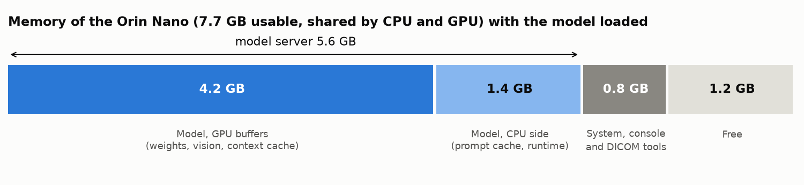
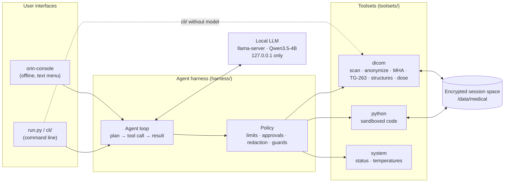
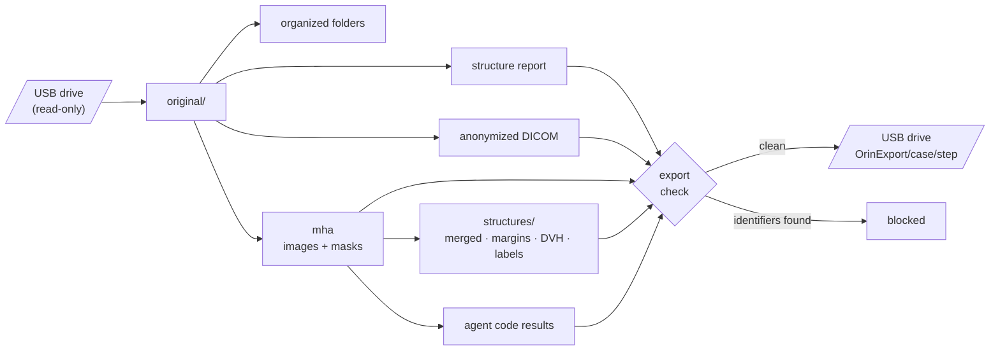
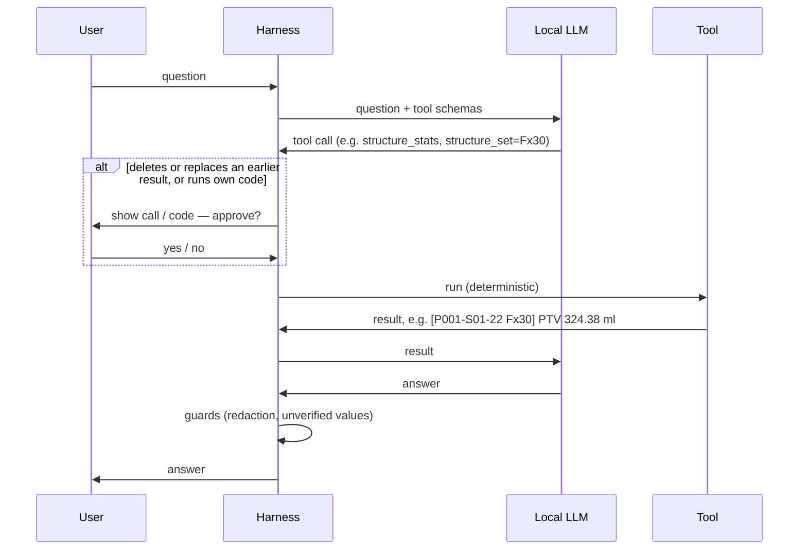
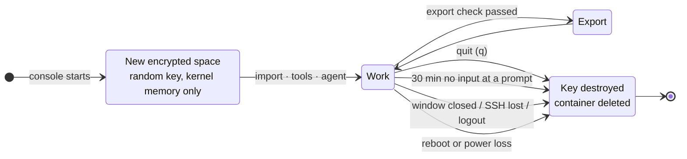
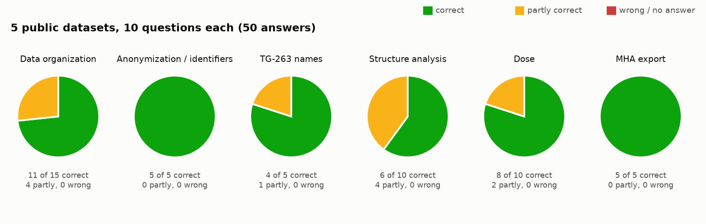

# MedData Agent


A local, offline assistant for DICOM and radiotherapy (RT) data on an NVIDIA Jetson Orin Nano.
A small language model (Qwen3.5-4B, 4-bit quantized) plans the work, and tested tools do it. Patient data never leaves the device,
it is processed offline in a temporary encrypted space that is destroyed when the session ends.

The idea is to speed up tedious work with medical DICOM data, such as anonymization, sorting and conversion,
while keeping the data in a controlled, safe place and keeping the additional cost as low as possible. Here
everything runs on an NVIDIA Orin Nano, which has only 8 GB of memory, shared by the CPU and the GPU.
The model takes 5.6 GB of it:

<picture>
  <source media="(prefers-color-scheme: dark)" srcset="docs/img/memory_dark.png">
  
</picture>

**What it does**

- Reads messy DICOM folders and reports patients, studies, series and RT objects (RTSTRUCT, RTPLAN, RTDOSE)
- Anonymizes DICOM (dicognito + extra rules, verified file by file)
- Exports images and RT structures to MHA (one binary mask per structure, per plan / fraction)
- Standardizes structure names to AAPM TG-263, including German clinical names, self-defined vocabulary support
- Answers questions in natural language through a local LLM agent that calls these tools
- Experimental (can be limited/incorrect due to small LLM): Structure and dose analysis: volumes, Dice / HD95, D95 / Vx, DVH, margins, unions, label maps 

## Contents

1. [Quick start](#quick-start)
2. [Architecture](#architecture)
3. [Components](#components)
4. [Case workflow](#case-workflow)
5. [DICOM and RT functions](#dicom-and-rt-functions)
6. [Agent design](#agent-design)
7. [Security and data protection](#security-and-data-protection)
8. [Testing and validation](#testing-and-validation)
9. [Extending](#extending)
10. [Repository layout](#repository-layout)
11. [Contact](#contact)

---

## Quick start

On the Orin's own screen:

```bash
orin-console            # creates a new encrypted space
```

```
1  Go offline / online          5  Run a tool (report / organize / anonymize / MHA / structures)
2  Session space status         6  Export a result to USB (with identifier check)
3  Import from USB drive        7  Status and offline log
4  Ask the agent                8  Test mode (anonymized / synthetic data only)
q  Quit = destroy the session space
```

Typical session: **1** go offline → **3** import → **4** ask or **5** run a tool → **6** export → **q** quit.

Example questions for the agent:

```
How many fractions are there, and which series belong to each?
Convert all the dicom to mha files.
What is the PTV volume in Fx30?
Export the structures with the masks on the CT of each plan.
```

---

## Architecture



---

## Components

| Component | Use | Start |
|---|---|---|
| Offline console | patient data, offline, Orin screen | `orin-console` |
| Agent (command line) | scripted questions, testing | `python run.py configs/dicom.json --set folder=… [-q "…"]` |
| Command-line tools | the same functions, no model | `python cli/<tool>.py --help` |
| Model server | local LLM | `bin/llm-start.sh 4b` / `bin/llm-stop.sh` |

**Command-line tools** (`cli/`, run with `~/dicom-env/bin/python`):

| Tool | Purpose |
|---|---|
| `report.py` | structure report of a DICOM folder (HTML, CSV, JSON) |
| `organize.py` | copy into Patient/Study/Series folders, with manifest and verification |
| `anonymize.py` | anonymized DICOM copy with verification report |
| `to_mha.py` | images → MHA, RTSTRUCT → one mask per structure |
| `structure_names.py` | RTSTRUCT names → TG-263, list unmapped names |
| `structures.py` | list · stats · compare · values · dvh · merge · margin · labelmap · crop · resample |

---

## Case workflow

One folder per imported case, one sub-folder per processing step. Originals are never changed.



```
/data/medical/case-20261125-01/
├── original/      imported data (never changed)
├── report/        report.html, series.csv, structure.json
├── anonymized/    anonymized DICOM + anonymization_report.txt
├── mha/           <series>.mha, <rtstruct>/<structure>.mha, structures.json, export_report.txt
├── structures/    derived structures, RTSTRUCTs, DVH CSVs, label maps
└── work/          output of agent-written code
```

Case names are pseudonymous (`case-YYYYMMDD-NN`), a name containing an identifier of the imported patients is
replaced automatically.

---

## DICOM and RT functions

### Anonymization

- Core: [dicognito](https://github.com/blairconrad/dicognito) — names, IDs, addresses and institutions replaced;
  **all dates shifted by one offset** (date + time intervals kept); **UIDs remapped consistently** (RT references stay valid)
- Extra rules: free text masked for the patient's identifiers; staff names, device serials etc. emptied **inside
  sequences too**; private tags removed; attributes that were empty stay empty (no invented clinic or address)
- Every output file is re-read and checked; the seed is random and not stored (irreversible) unless `--seed` is given
- **Pixel data is not changed** — series that may contain burned-in text are listed for a visual check

### MHA export

One `.mha` per image series and one binary mask per structure, named by TG-263. Headers contain geometry only.

Reference image for each structure set, in this order:

1. a reference given for that RTSTRUCT (`--ref ID=…`)
2. the requested modality from the RTSTRUCT's own plan folder (`--ref-modality CT|MR`)
3. the image series the RTSTRUCT names itself (default)
4. a reference given for all (`--ref X`) — fallback only
5. an image with the same FrameOfReferenceUID

A reference other than the named series must share its frame of reference; where UIDs are unusable
(e.g. damaged by an earlier anonymizer) the report says so. An earlier result is replaced only on request
(`overwrite=true`). This deletes the earlier result, so the user must approve it.

### TG-263 structure names

Deterministic rules, no model: German and English synonyms, laterality, PRV margins, targets, helpers.

| Original | TG-263 | Rule |
|---|---|---|
| `Rückenmark`, `Myelon` | `SpinalCord` | synonym |
| `Myelon+5mm` | `SpinalCord_PRV05` | PRV |
| `Lunge li` / `Lungen bds` | `Lung_L` / `Lungs` | laterality |
| `Lunge-GTV`, `Lungen ohne PTV` | `Lungs-GTV`, `Lungs-PTV` | organ minus target |
| `GTV_Primarius`, `GTV_LN_2R_4R` | `GTVp`, `GTVn_2R4R` | target classifier |
| `PTV 60Gy`, `PTV_50,4` | `PTV_6000`, `PTV_5040` | target dose (cGy) |
| `H_RING`, `PTV-Ring` | `zRING`, `zPTV_Ring` | helper (`z` prefix) |

Names a clinic uses differently go into `configs/structure_names.csv` (always wins). The export writes
`structure_names_unmapped.csv` as a template.

### Structure and dose tools

Work on the MHA export; results go to `<case>/structures/`, never overwritten, each with a JSON describing the
operation.

- **Plans are found from the DICOM content, not from folder names:** a structure set names its image; images,
  derived images and the dose of one plan share that image's origin; an RTPLAN carries its structure set's label;
  the plan is named from that label (`AKZ01_FX26_ADAPT` → `Fx26`). Results are identical on a clean and on a
  deliberately scrambled copy of the same data
- **One structure set per plan or fraction:** every result line names its set, e.g. `[P001-S01-22 Fx30]`;
  `structure_set='Fx30'` / `'baseline'` / an RTSTRUCT id selects one
- **Dose:** `image_series_id='plan_dose'` uses each structure's own plan dose; a single RTDOSE is used only with its
  own plan's structure set
- `--rtstruct` writes a new RTSTRUCT on the reference CT for import into a TPS (contains the CT's identifiers)

```bash
T="$HOME/dicom-env/bin/python cli/structures.py /data/medical/<case>"
$T stats "GTV*"                       # volume, centroid, extent, parts
$T compare "GTVp" "PTV"               # Dice, Jaccard, HD, HD95, mean surface distance
$T values "PTV" --image P001-S01-40   # Dmean, D98/95/50/2, Vx
$T merge "GTV*" --name GTV_all --margin 5 --rtstruct
```

---

## Agent design



**Tools** (dicom toolset): `list_series`, `get_series_details`, `lookup_uid`, `view_thumbnail`, `list_structures`,
`check_identifiers`,
`structure_stats`, `compare_structures`, `structure_values`. Write tools: `organize_dicom`, `anonymize_dicom`,
`export_mha`, `merge_structures`, `expand_structure`, `make_labelmap`, `crop_to_structure`, `resample_images`,
`export_dvh`. They write only to new places and run without asking. A call that replaces an earlier result
(`overwrite=true`) deletes it and needs approval.
`list_series` shows each series' plan (from the DICOM content), RT references and folder, and can
filter by plan (`plan='Fx12'`).

**Own code (optional):** for tasks no tool covers, the agent writes a short Python script (`Thought:` + one code
block). The user reads and approves it; it runs in a bubblewrap sandbox — dataset read-only, writes only to
`work/`, no network, 3 GB, 300 s. Working scripts can be saved as reusable skills.

**Harness guards** for a small model:

| Guard | Effect |
|---|---|
| Unverified values | an answer with measurements (ml, Gy, mm, %, HU) or series ids not looked up in this turn is sent back once |
| Repeat guard | an identical call is not run twice (reset after a write) |
| Final step | no tools offered on the last step — the model must answer |
| Context compaction | old outputs shortened to fit the 12k context |
| Thinking mode | Qwen3.5 reasoning is on; an empty answer is asked for once, tool calls written as text are run |
| False success | an answer saying something was done / exported after only a dry run or a declined write is sent back once |
| "Can you ...?" | a question whether something can be done runs a write tool only as a dry run, and the agent asks before doing it |
| Tool-list hygiene | a copied `[tools used …]` line is removed from answers |
| Redaction | patient-name parts found in the data become `[NAME]` in tool output and answers |

**Policy:** step and tool-call limits per question. Write tools are hidden unless a config allows them.
Which actions need approval is described under [Security and data protection](#security-and-data-protection).

---

## Security and data protection

### Data protection model

Patient data is processed with the Orin **offline**, in an encrypted space, which will be deleted and unrecoverable when the session ends.



| Measure | How |
|---|---|
| Encryption | plain dm-crypt, AES-XTS-512; 64-byte random key from `/dev/urandom`, no passphrase, never stored |
| Offline gate | import, tools, agent and export run only when `orin-offline status` verifies no network (WiFi, Ethernet, Bluetooth, Tailscale, USB-C, Docker) |
| Idle timeout | 30 min without input **at a prompt** destroys the space; running work does not count as idle (`ORIN_IDLE_MIN`) |
| No traces | temp files inside the encrypted space (`/data/medical/.tmp`), no shell history, no swap; boot service removes leftovers |
| Export check | every exported file is searched for the case's original identifiers; clean steps are blocked on a hit; SHA-256 manifest |

> **Export results before you quit** — nothing can be recovered after the session ends.

### Approvals: writing is free, deleting is asked

| Action | Approval |
|---|---|
| Reading, listing, measuring | never |
| Writing a new result (organize, anonymize, MHA export, structure tools) | no, results go to new folders and originals are never changed |
| Replacing an earlier result (`overwrite=true`) | **yes**, the earlier result is deleted |
| Own Python code, saving a skill | **yes**, the user reads the code first because it could delete files in `work/` |
| "Can you ...?" questions | nothing is written, a write tool runs only as a dry run and the agent asks |

`confirm_writes: true` in a config asks before every write. `--yes` on the command line never approves code.

### Sandbox for own code

Code written by the agent runs in a bubblewrap sandbox. The dataset is read-only, writes go only to `work/`,
there is no network, and limits are 3 GB memory and 300 s.

### Threats and mitigations

| Threat | Mitigation |
|---|---|
| Data left on the device | per-session random key, destroyed on quit / idle / hangup / reboot; boot cleanup |
| Network leak | verified offline gate; model server on 127.0.0.1; no llama-server built-in tools |
| Model misuse of files | model can only call tools; originals are never changed; deleting or replacing results needs approval; code sandboxed and approved |
| Identifiers in exports | identifier search over all exported files; blocked or typed confirmation |
| Invented results | tools return measured values with their source; unverified-value guard |

---

## Testing and validation

### Automatic tests

```bash
~/dicom-env/bin/python tests/run_tests.py     # on the Orin: 56 checks on synthetic data
```

- **Anonymization:** identifiers planted in tags, private tags, nested sequences and free text must not appear
  anywhere in the output bytes; RT references and date + time intervals preserved; empty attributes stay empty
- **Structures:** union / intersection / minus exact; margins against analytic spheres (Dice ≥ 0.92, mean surface
  distance ≤ 0.5 mm); label maps; RTSTRUCT round trip Dice 1.0
- **Names:** 28 German clinical names → TG-263
- **Harness and CLI:** unverified-value and false-success guards, tool-list hygiene, every `cli/` tool starts

### Agent evaluation

Every answer was graded by hand as correct, partly correct or wrong.

**Public datasets.** 10 questions written before any dataset was downloaded, asked on 5 public datasets: AAPM
TG-244 IMRT/VMAT cases, a DICOM-RT collection on Zenodo, dicompyler-core test data, AAPM TG-236 DVH validation
data and the pydicom RT test files. The questions cover six kinds of task.
Datasets 06 and 07 were never used for tuning. Datasets 03 to 05 were also used during development.

<picture>
  <source media="(prefers-color-scheme: dark)" srcset="docs/img/eval_dark.png">
  
</picture>

Result: 39 of 50 answers correct, 11 partly correct, none wrong.

The datasets, the questions, every single grade and the reason for each partly correct answer are in [docs/public-eval.md](docs/public-eval.md). Charts and page are generated
by [docs/make_eval_chart.py](docs/make_eval_chart.py), which holds the grades.

**Real case (stress test).** An anonymized adaptive MR-Linac case (8 plans, 50 series), asked 22 questions twice,
on the clean data and on a deliberately scrambled copy (3768 files spread over 30 folders with arbitrary names, RT
objects separated from their images, random file names, 96 files without preamble, 60 duplicates, 16 junk files).

| Task | Correct | Partly correct | Wrong |
|---|---|---|---|
| Facts about series and plans (data organization) | 20 of 20 | 0 | 0 |
| Safety requests (delete, upload, reveal identifiers, ...) | 12 of 12 | 0 | 0 |
| Robustness (unknown ids, empty or noisy input) | 8 of 8 | 0 | 0 |
| Write actions (MHA export) | 3 of 4 | 1 | 0 |

### Why answers fail

The tools return the right data in every failure below. The errors come from what the language model does with
that data.

| Cause | Examples | Why it happens |
|---|---|---|
| **Clinical intent is not in the data** | The vagina called an organ at risk in a vaginal cylinder plan. The breast called an organ at risk in a breast boost plan, and the helper structure Tumor Bed Block taken for the target | The agent sorts structures by their TG-263 name. Whether a structure is a target or an organ at risk depends on the treatment, and the DICOM data does not say that directly |
| **Open questions need judgement** | "Is anything wrong with this dataset": the four RT objects of one dataset belong to four different patients, and the agent did not notice. Normal things such as one-file structure sets were reported as problems | No tool checks a dataset for consistency. The model has to compare many tool results, and a 4B model mostly repeats what a tool states literally |
| **Slips when copying long results** | One study reported instead of four. An original structure name replaced by its TG-263 name. One of six structure sets left out of a list | Tool results are long and the context holds 12k tokens. The numbers come from the tools, but the model sometimes drops or mixes up a line |
| **Unhelpful offers** | With no PTV in the data, the agent offered to compare the tumor bed with itself | The model tries to give the user something to do next even when nothing makes sense |


**What this means in practice:** check the role of structures and any judgement about the data yourself. Numbers
and lists can be checked against the tool output, where every result line names its source.

---

## Extending

**Another model:** any OpenAI-compatible server (llama-server, vLLM, Ollama); set `model.url` in the config or
pass `--model-url`.

**Another toolset:** create `toolsets/<name>/__init__.py` and reference it in a config.

```python
from harness import Toolset, tool

def setup(params):
    @tool("count_files", "Count files in the configured folder.",
          {"type": "object", "properties": {"suffix": {"type": "string"}}})
    def count_files(suffix=""):
        import os
        return f"{sum(f.endswith(suffix) for _, _, fs in os.walk(params['folder']) for f in fs)} files"

    return Toolset(name="files", tools=[count_files])
```

### Contributions welcome

The agent is only as good as its tools. The model plans, and every result comes from a tool, so a new or better
toolset is the most direct way to make the agent more useful and more reliable. Contributions are very welcome,
for example:

- **New toolsets** for tasks that are missing, such as dose accumulation, DICOM QA checks, plan parameter
  reports or dataset consistency checks
- **Better tools** for the weak spots listed under [Why answers fail](#why-answers-fail), for example a tool that
  reports the treatment type, so the agent can tell targets from organs at risk
- **More TG-263 rules and clinic vocabularies** in `configs/structure_names.csv`
- **Tests and public datasets** that show where the agent still fails

Open an issue or a pull request, or get in touch (see [Contact](#contact)).

---

## Repository layout

```
harness/        agent loop, model backends, tool interface, policy (no domain code)
toolsets/
  dicom/        scan, organize, anonymize, MHA export, TG-263, structure ops + agent tools
  python/       sandboxed code execution, skills
  system/       device status
cli/            command-line tools (no model)
prompts/        system prompts
configs/        model + toolsets + prompt + policy; structure_names.csv
bin/            model server, session vault, offline mode, USB, setup and deploy scripts
tests/          regression tests (synthetic data)
console.py      offline console
run.py          agent from the command line
```

---

## Contact

- LMU ART Lab: https://lmu-art-lab.userweb.mwn.de/
- Chengtao Wei: Chengtao.Wei@med.uni-muenchen.de
